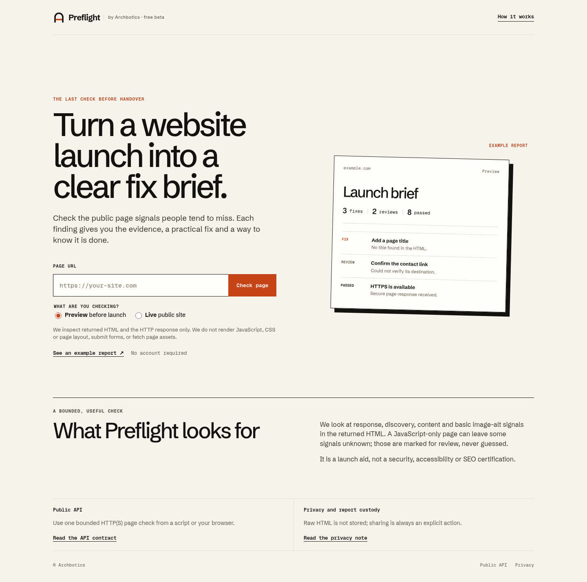

# Preflight by Archbotics

Check a public webpage before handover. Preflight turns observable HTML and HTTP details into an evidence-backed fix brief for a developer or coding agent. Preview and Live modes distinguish deliberate staging settings from launch mistakes.

**Public beta:** https://preflight.archbotics.workers.dev

[Release and deployed verification](docs/RELEASE.md) · [API](docs/API.md) · [Operations](docs/OPERATIONS.md)



- 16 source checks with evidence, suggested change and acceptance check.
- Copy/download a Markdown brief or JSON report.
- No account, model API, page screenshot service or email required.
- Share only when you choose to. Links expire in seven days; the creator can revoke one immediately.
- HTTP API supports agent workflows. See [API](docs/API.md).

This is a single-page source check. It does not execute JavaScript, render CSS, test form submission, crawl linked pages, measure performance, certify accessibility/security, or predict rankings/conversion. Heuristic findings need human review. Missing signals in a JavaScript shell are marked as unknown rather than treated as confirmed omissions.

## Run

Requires Node 22+ (tested with Node 26), npm and Python 3 for the optional operator wrapper.

```sh
npm ci
npm run dev
```

The local app runs at `http://localhost:8787`. To test sharing locally, create an ignored `.dev.vars` with non-production `REPORT_SECRET` and `ADMIN_TOKEN` values of at least 32 characters. Cloudflare bindings run locally with Wrangler. Production secrets never belong in that file or in git.

```sh
npm test
npm run check
npm run build
```

Browser tests use the installed Chromium or `CHROMIUM_PATH`, and a running local server. Deployment checks and rollback: [Operations](docs/OPERATIONS.md). Product decision and limits: [PRODUCT.md](PRODUCT.md).

```sh
npm run test:browser  # real example UI, layout, Axe and Markdown download
npm run smoke        # real network scan/share/delete; six write requests
```

## Architecture

Static HTML/CSS/JavaScript on Cloudflare Workers Static Assets; a small Worker fetches a bounded HTML response and runs a deterministic parse5 analyzer. An SQLite Durable Object enforces the daily scan budget and stores explicitly shared reports with deletion and expiry. No visitor IP, request headers, or raw fetched HTML enters that object. HMAC signatures prevent altered client reports being shared as server findings.

All target URLs and redirect destinations pass URL/IP/domain validation and public DNS preflight. `global_fetch_strictly_public` forces public Internet routing; no private-network binding exists. DNS checks are preflight only and cannot pin the later hostname resolution. See the operational limitations before adapting this into a private-network environment.

## Why this product

Built to help Archbotics' website delivery workflow catch unfinished details and hand the fixes to the next agent. Existing crawlers already provide many checks; the intended value here is a small hosted workflow and a useful handoff. Customer demand and willingness to pay are untested. Research notes: [Decision](docs/DECISION.md).

## License

Apache-2.0 for the application. The self-hosted Schibsted Grotesk and Geist Mono fonts carry their included SIL Open Font License texts. Archbotics brand assets identify the operator; the code license does not imply endorsement of a fork.
